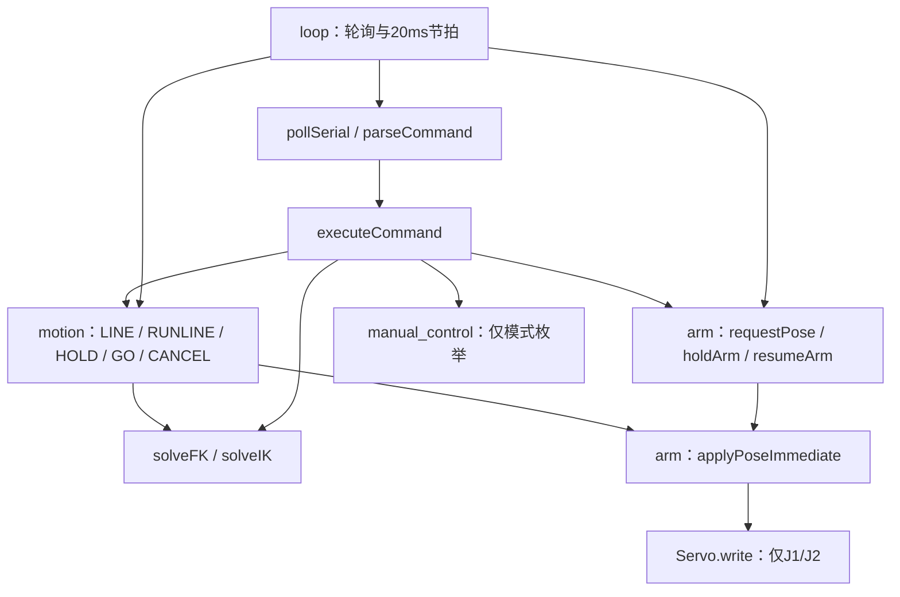

# MeArm 控制组：真实仓库审计与接口冻结 V1

审计日期：2026-10-12（北京时间）。正式截止：2026-10-18 23:59。内部节点：10/16 功能冻结，10/17 联调与材料，10/18 复查并提前提交。

本报告覆盖用户要求的控制/算法全部任务，以及额外的通用 Cartesian 摇杆模式。第一轮仅做仓库读取、独立副本构建和模拟检查，未改动生产源码，未创建远端提交、PR 或 tag，未烧录或驱动机械臂。下面的“新增接口”是设计契约，不是已实现声明。

## 1. 审计范围、基线与证据边界

真实仓库：[C-B-Camellia/mearm-arduino-control](https://github.com/C-B-Camellia/mearm-arduino-control)。从已连接 GitHub 找到唯一名称匹配的仓库，并成功克隆全部可见分支。

| 分支 | HEAD | 内容与本次用途 |
|---|---|---|
| `master`（默认） | `b4e7de0f97e46a0b4911d7651bb308a6875f6baa` | 较早的单文件四轴摇杆控制；读取源码，用作旧输入逻辑参考 |
| `refactor-architecture` | `20335f2d09cd8b7ce186f6c625abc225dcbda850` | 二维控制模块化、串口解析与线任务；独立运行历史桌面测试 |
| `cartesian-trajectory` | `07968aab2392ad49092c10cce919afcb969a1bc2` | 最新远端开发提交，2026-10-11 22:34:54 +08:00；本报告主审计对象 |

三个分支位于同一条开发历史上，可见 12 个提交。最新分支不是默认分支，评审材料必须明确最终代码位置，冻结后再决定将已验证版本合入默认分支。用户电脑上的未提交改动、未推送提交和当前实际烧录版本不可见；不能据此认定远端 HEAD 与实机一致。

完整读取：6 个生产 `.cpp`、6 个业务/配置 `.h`、`platformio.ini`、README、全部已提交桌面测试及模拟 Arduino/Servo 头文件；另读取旧 master 的完整 `main.cpp`。`joystick`、`recording`、`teaching`、`button_link`、`app_controller`、三维运动学和抓放模块均未出现在最新远端树中。`lib` 无自定义实现，`test/README` 仍为模板。

外部依据：已读交接包、Tutor Brief、Curriculum、S1，以及考核原件算法第 4–7 页、机械物体定义第 3 页和提交第 11–14 页。长期 STM32 训练线保持原有 Gate，本周按用户明确授权完成 MeArm 考核，不据此宣布其他 Gate 通过。

证据分类：

- **源码事实**：当前提交可直接读取的实现与参数。
- **模拟检查**：主机编译与模拟 Serial/Servo/时间；不能证明脉宽、电气、舵机落位或纸面效果。
- **用户报告**：机械臂和夹爪已调好，按钮板预计 10/13 到货；缺少对应固件 HEAD、角度表和测量附件。
- **未验证**：四轴真实控制、UART 板间链路、三维模型、笔尖标定、HOME 路径、纸面图形、录制回放、全部抓放行为。

## 2. 构建、测试与 SRAM 状态

### 2.1 已完成的主机检查

工具：Linux `g++ 13.3.0`，`-std=c++11 -Wall -Wextra -Wpedantic`。使用仓库现有桌面替身编译真实生产源码，编译退出码 0；无编译警告输出。

```bash
g++ -std=c++11 -Wall -Wextra -Wpedantic -Itest/native -Iinclude \
    src/*.cpp test/native/test_main.cpp -o native-baseline
./native-baseline
```

**最新提交测试失败**，运行退出码 1：

```text
FAIL line 116: motionStatus().totalWaypoints == 7
```

原因：`config.h` 已把 `LINE_STEP_MM` 从 5 改为 4、`WAYPOINT_DELAY_MS` 从 1000 改为 10；测试仍要求 7 个点、1000 ms 等待和 7000 ms 总时长。同一测试运行在 `20335f2` 历史提交时输出 `PASS: 535 checks`。这证明历史测试与历史配置相符，不能用历史 PASS 宣称最新固件通过。当前测试提前退出，后续测试并没有在最新参数下全部执行。

README 的 `test/native/run.ps1` 未提交，文档中的测试启动命令无法按仓库复现；`pio test` 也没有已配置的 native 环境。模式切换未在当前测试中覆盖。

### 2.2 Uno 目标构建

原工程 `pio run -e uno` **未完成**（退出码1）：`atmelavr@5.3.0`和AVR工具链已安装，`framework-arduino-avr ~5.4.0`因镜像超时/下载校验不匹配无法安装；尚未开始该命令下的源码编译。没有跳过下载校验。

为核查真实目标源码，另外从官方Git仓库克隆了固定标签，使用相同ATmega328P/16MHz目标和AVR工具链做独立交叉构建，编译、归档、链接及HEX生成成功：

| 项目 | 固定版本/结果 |
|---|---|
| AVR GCC | 7.3.0，PlatformIO下载的`toolchain-atmelavr@1.70300.191015` |
| ArduinoCore-avr | 官方`1.8.6`，`42fa4a1ea1b1b11d1cc0a60298e529d37f9d14bd` |
| Servo | 官方`1.3.0`，`2862ad9864d0dda5669b264857deafbba624940d` |
| 目标/编译参数 | `atmega328p`, `F_CPU=16000000L`, `gnu++11`, `-Os`, `-flto`, section GC；core/Servo分别静态归档再链接 |
| `.text` | 15124 B |
| `.data` | 210 B |
| `.bss` | 328 B |
| 静态SRAM | **538 B / 2048 B = 26.3%**；其余1510 B为静态未占用空间，尚需栈/中断/其他运行时开销 |
| Flash加载量 | `.text + .data = 15334 B`；Uno应用上限32256 B时约47.5% |

这组数字来自新生成ELF及`avr-size -A`，不是主机`sizeof`估算。符号表可识别关节表100 B、PC行缓冲64 B、LineTask35 B、HardwareSerial对象157 B（含RX/TX缓冲）、Servo内部表36 B及对象12 B等。**它证明该固定上游依赖组合下的Uno目标可编译，不能宣称原PlatformIO依赖解析已经成功，也不能把538 B作为用户电脑上未知框架版本的实测。** 原`platformio.ini`未锁platform/Servo版本，最终release必须记录并固定用户实际构建依赖，再用完整`pio run`复核。

当前应用已有约15 KB Flash；新增所有功能时仍需逐提交观察Flash，不能只关心SRAM。加入候选128帧768 B后，简单预算为1306 B，再计五点40 B后1346 B；距1536 B初始门槛仅190 B，必须为新任务状态、链路缓冲及校准数据重新预算，不能直接照搬160帧方案。

### 2.3 内存审计规则与新增预算

目标硬件 SRAM 总量为 2048 B。当前生产代码未使用 `String`、`vector`、`new` 或显式 `malloc`；桌面替身中的 STL 仅用于主机测试。静态资源包括四关节表、四个 Servo 对象、单个 LineTask、64 B 命令行缓冲、串口框架收发缓冲及库状态。不能把这些源码估算相加后写成“实测 SRAM”。

最终容量由 Uno ELF 的 `.data + .bss + .noinit`、符号表和最深调用/中断栈共同决定。每个提交记录 Flash、静态 SRAM 和变化量；静态占用小于 1536 B、至少预留 512 B 是本项目的初始工程门槛，仍需测最坏日志/浮点/IK调用及中断嵌套下的栈高水位，不能把 512 B 当作官方安全保证。

| 新增数据 | 初始方案 | 字节预算/条件 |
|---|---|---|
| 五个示教点 | `TeachPoint{float x,y}` × 5 | AVR float=4 B 时为 40 B；另计状态、drawZ/travelZ和顺序 |
| 录制帧 | `RecordedFrame{uint8_t joint[4]; uint16_t elapsedMs;}` × 128 | 用 `static_assert(sizeof(RecordedFrame)==6)` 验证后为 768 B；100 ms 节拍，约覆盖 12.7 s，必须手动第二次按键结束并展示 >10 s |
| 路径/曲线 | 仅保存 5 个点及段号、参数、速度状态 | 按需采样、两遍增量预检/执行；不保存全路径点列 |
| 抓放参数 | 三套固定阶段表 | 固件常量可用 PROGMEM；参数尚未标定，不能填猜测角度 |
| 外部串口 | 例如短帧 `B1\n` 的固定缓冲 | 软件串口库自身接收缓冲必须另计；传输方案尚未冻结 |

128 帧方案是预算候选，尚未准许分配。采用时间戳是为了保留 superloop 延迟造成的实际采样间隔；若改成四字节固定节拍帧，需要证明不会丢采样或伪造间隔。缓冲满后停止并报告原因，不覆盖；录制时长严格大于 10000 ms。断电保存到 EEPROM 不在原文明确要求中，本版先定义为 RAM 中保存，说明文档写明断电丢失。若容量不足，先精简状态/日志/缓冲，再调整记录表示；不能牺牲安全检查。

## 3. 真实调用关系与状态所有权

### 3.1 当前调用关系



`loop`：先处理最多 64 字节及一行 PC 命令；每 20 ms 且 motion 不忙时 `applyPendingPose()`；随后 `updateMotion()`。预检每次 loop 验一个点；执行仅控制节拍下推进一个点。`main` 没有 ADC 采样、手动更新、四键串口或录制调用。

### 3.2 当前状态及问题

| 状态 | 当前 owner | 审计结论 |
|---|---|---|
| commanded/goal 角度、限位、引脚 | `arm.cpp` 的公开 `joints[]` | 有完整 Pose 检查，但外部可以直接修改表；commanded 实际存未量化 float，不完全等于 Servo.write 参数 |
| `posePending` | arm 私有 | 含义明确：存在普通待发目标 |
| `held` | arm 私有 | **混用**：人工 HOLD 与一次目标已执行；这直接阻塞模式切换 |
| task.kind/state/path/等待/索引 | motion 私有单一 `LineTask` | 现有自动 owner 可复用；暂停保存阶段、索引与余下等待；仅有二维预览/执行 |
| `currentMode` | manual_control 私有 | 只存枚举，不负责输入、积分、目标同步 |
| `configuredMoveSpeed` | commands 私有 | 只写/打印，motion 无法访问，不改变速度 |
| 串口缓冲、丢弃标记 | commands 私有 | 溢出丢弃直到换行，轮询有界；暂无超时与链路帧校验 |

`solveIK()` 内部调用 `isSafePlanarPose()`，因此当前运动学并非完全独立于 arm；V1保留该接口与既有物理解分支，先不为“纯数学”重写有效模型。三维扩展显式使用校准参数和 Pose 校验。

### 3.3 已复现缺陷与处理优先级

| 编号 | 严重性 | 真实证据 | 处理契约 |
|---|---|---|---|
| A01 | 安全优先 | float `20.9+127.1=148` 通过；Servo写 `20+127=147` | 输出量化后再次全 Pose 检查；任何失败不得写任何关节、不得部分更新状态 |
| A02 | 功能阻塞 | 空闲 `pending=0 held=1`；`MODE CART` 返回 busy | held 只表示显式 HOLD，不在正常输出后自动置位；request不得暗中解除HOLD |
| A03 | 验证阻塞 | 最新 native 测试第116行失败 | 为实际4mm/20ms行为重建期望和暂停/时钟回绕回归，保留独立数值期望；不能把常量改回旧值来假装修好 |
| A04 | 考核缺口 | `SPEED` 只影响打印 | 统一速度配置应被手动与自动轨迹真正读取，并计入关节最大速度限制 |
| A05 | 考核缺口 | `cancelMotion()` 清空后 hold，无 HOME | 分离低层停任务和绘图取消回待机；安全恢复轨迹由 motion 执行 |
| A06 | 接口保护 | `initializeArm()` 直接 attach/write；未验证启动 Pose | attach前整体验证配置及输出姿态；软件重启不假设机械已在该姿态，新关节不得默认开启 |
| A07 | 可复现性 | README引用不存在的run.ps1；仍写5mm/1000ms | 补真实启动脚本/命令及当前参数说明 |
| A08 | 实机风险 | RUNLINE 每4mm约20ms一步，未限制关节角增量 | 时间参数化、逐步输出约束、近奇异速度约束；20ms更新不等于实机20ms到位 |
| A09 | 可观测性 | STATUS先换行，再输出mode但不结束行 | 一条状态快照完整换行；加所有四关节、workflow、校准、错误与录制信息 |

第一项立即任务选 A01。A02、A03紧随其后；本轮不把三项同时交给用户。

## 4. 当前仓库与目标架构的接口差异表

| 能力/模块 | 当前真实接口或行为 | 冻结目标与处理 |
|---|---|---|
| arm安全入口 | `isSafePose / requestPose / applyPendingPose / applyPoseImmediate` | 保留Pose；增加输出量化及最后输出检查；即时输出收为arm内部；主循环唯一发出PWM |
| 输出所有权 | commands和motion分别直接操作arm | app仲裁；motion占用时手动/新任务拒绝，暂停也保持owner；低层arm不能决定业务 |
| 摇杆 | latest无实现；master有 `readJoystick / updateJoint / updateCoupledJoints` | 复用ADC中心/方向作为待核对初值；新增纯输入 `readJoysticks / joysticksCentered`；旧直接Servo调用不能复制 |
| 手动JOINT/CART | get/set模式，无update | 原地扩展manual_control；积分、dt上限、模式切换同步；四轴JOINT及XYZ/J3 CART |
| 二维数学 | `solveFK(float,float) / solveIK(float,float)` | 保留签名、单位、坐标和解分支；不能悄悄给旧z加38mm |
| 三维数学 | 无 | 新增工具点FK3D/IK3D与校准有效性；底座/肩部/工具偏置明确 |
| 自动轨迹 | `startLine(Point2D,TaskKind) / updateMotion(now,controlDue)` | 保留二维诊断兼容；扩展一个task owner到Move/Home/Pick/Draw/Playback；不复制调度器 |
| 暂停/继续 | `pauseMotion / resumeMotion` | 保留签名并扩展保存任务阶段、轨迹参数及等待；不把暂停时间计入轨迹 |
| 取消 | `void cancelMotion()` 只停止 | 保留内部abort含义；新增 `cancelAndReturnHome()` 负责用户绘图取消与受控恢复 |
| HOME | 无 | 已验收配置 + 安全经由点；`startHome()`；无配置时拒绝 |
| O/S/H/L、三舵机角度 | 均无 | 明确动作类型/三参数原子解析；O/S用真实夹爪角；H/L改统一倍率 |
| A/B/C抓放 | 无 | motion阶段任务 + 三套抓放参数表；PC/实体按钮共用入口 |
| 四键事件 | 无 | button_link只解析；app唯一业务映射；PC `BTN`模拟调用同一分发 |
| 录制/回放 | 无 | recording有界帧；仅手动时记录真实下发的四关节指令；回放由motion执行 |
| 五点示教 | 无 | teaching存XY、drawZ/travelZ和5点顺序；实体MARK + PC诊断；运行中点集只读 |
| 纸面线/图形/折线/曲线 | 只有竖直x/z平面二维直线 | 新建XY纸面路径采样函数，共用三维执行器；不得把RUNLINE当纸面直线通过 |
| 文档/证据 | README旧版；无任务四文档 | Word可编辑公式推导、说明文档、视频、完整源工程、GitHub网址txt及个人/小组材料 |

## 5. 最终逻辑接口冻结方案

冻结的是职责、签名和行为；以下硬件常量另列待确认项，未确认前相关功能明确报 `Uncalibrated/Disabled`。不强制拆十几个文件：path与pick常量可留motion；小型app可留commands同一翻译单元，但只能有一份分发逻辑。

### 5.1 状态与输出规则

1. **arm**独占关节配置、goal、最后下发的量化Pose、pending、显式held及Servo。对外 `commandedPose()` 返回最后实际传给Servo的指令角；它依旧不是位置反馈。manual保存连续积分目标，不污染commanded语义。
2. **motion**独占所有自动任务及取消恢复过程；任务Paused/Validating也算busy。自动任务期间手动不提交；recording不启动；新任务返回Busy。
3. **manual_control**独占ControlMode、手动连续目标和dt基准。模式切换无活动任务、无pending、无显式hold、摇杆回中；CART还要求三维校准有效。切换成功仅同步目标，不提交运动。
4. **teaching**独占5点、平面配置、点数；app独占Workflow。进入/退出工作流同步目标、重置dt；MARKING锁z=travelZ，禁止任务期间修改点集。
5. **recording**独占Empty/Recording/Ready及帧；Playback属于motion，不存在另一条Servo输出路径。
6. **control_settings**独占整体速度倍率和四关节速度上限，commands只请求修改。JOINT为deg/s、CART为mm/s，倍率共同作用；不能把两种单位混为一个数。
7. `requestPose()`只排入完整合法候选；`applyPendingPose()`只在main控制节拍发出；改main当前“不忙才输出”的条件，允许motion排入的目标发出。motion须等待pending消费后才推进软件进度。每tick至多一Pose、无补发突发。
8. 自动关节移动/HOME使用相同插值比例，检查所有离散输出；绘图以时间参数化的Cartesian样本IK输出，步长同时满足关节速度上限。低层输出在量化后再校验，失败整帧拒绝。几何限位并不证明无桌面/障碍碰撞，HOME经由点需要实机确认。
9. 显式HOLD期间新运动拒绝；GO恢复任务或解除空闲hold，不复活已取消目标。内部任务完成只清owner并同步目标，不调用人工hold。绘图取消先停止旧轨迹，验证恢复路径，再以受限轨迹回待机；恢复失败保持最近安全指令并明确错误。
10. 软件DONE是命令发送与配置等待结束，不宣称真实到位。禁用关节只保存配置标称值，状态注明disabled。

### 5.2 冻结的公开接口与复用/修改/新增

下列是头文件设计草案。`bool`沿用现有返回风格；失败原因通过模块status的ErrorCode取得，供app串口统一输出；只返回true而无实际动作或把失败当成功都不允许。

```cpp
// arm.h：保留类型与多数签名
Pose commandedPose();
Pose goalPose();
bool isSafePlanarPose(float j1, float j2); // 原有几何合法性
bool isSafePose(const Pose& pose);        // float几何合法性
bool prepareOutputPose(const Pose& candidate, Pose& output); // 新增，量化后复核
bool requestPose(const Pose& candidate); // 修改：held不暗中解除，失败无副作用
bool applyPendingPose();                // 修改：输出后不自动held
bool hasPendingPose();
bool isArmHeld();                       // 修改：仅显式HOLD
void holdArm();
void resumeArm();
// applyPoseImmediate移入arm内部，仅经prepareOutputPose后的完整输出使用

// joystick.h：新建；不返回带deg/s业务含义的数据
struct JoystickInput { int8_t lx, ly, rx, ry; }; // -2..2
JoystickInput readJoysticks();
bool joysticksCentered(const JoystickInput& input);

// manual_control.h：原地扩展
ControlMode getControlMode();
bool setControlMode(ControlMode mode);
void syncManualTarget(uint32_t nowMs);
void updateManualControl(uint32_t nowMs, const JoystickInput& input);

// kinematics.h：原有二维签名不变
FKResult solveFK(float shoulderAngle, float elbowAngle);
IKResult solveIK(float x, float z);
struct Point3D { float x, y, z; }; // 世界/纸面工具点mm
struct IKResult3D { bool valid; float j0, j1, j2; };
bool isCartesianCalibrationValid();
Point3D solveFK3D(float j0, float j1, float j2);
IKResult3D solveIK3D(const Point3D& target);

// motion.h：沿用唯一调度器
bool isMotionBusy();
MotionStatus motionStatus(); // 扩展任务种类、阶段、错误、进度
bool startLine(Point2D target, TaskKind kind); // 保留旧二维诊断
bool startJointMove(const Pose& target);      // 新增：原J/三舵机/夹爪命令入口
bool startCartesianMove(const Point3D& target);
bool startHome();
bool startPickPlace(uint8_t index);           // 0..2
bool startDrawLine(const TeachPoint& a, const TeachPoint& b);
bool startBasicShape(ShapeId shape);          // N / Triangle / Z / V
bool startPolyline();                        // 使用冻结的当前5点顺序
bool startCurve();
bool startPlayback();
void updateMotion(uint32_t nowMs, bool controlDue);
bool pauseMotion(uint32_t nowMs);
bool resumeMotion(uint32_t nowMs);
void cancelMotion();                         // 低层终止，保持姿态；不暗中HOME
bool cancelAndReturnHome();                  // 应用绘图取消，安全恢复任务

// teaching.h：新增
struct TeachPoint { float x, y; };
bool beginTeach();
bool setTeachHeightFromCurrentPose(bool forDrawing);
bool beginMarking();
bool markTeachPoint();
void clearTeachPoints();                     // 仅非任务时调用
uint8_t teachPointCount();
bool setTeachOrder(const uint8_t order[5]);   // 严格检查1..5各出现一次
bool getTeachPoint(uint8_t index, TeachPoint& out);

// recording.h：新增
bool startRecording(uint32_t nowMs);
bool stopRecording(uint32_t nowMs);
void updateRecording(uint32_t nowMs, const Pose& commanded);
bool hasRecording();
bool getRecordedFrame(uint8_t index, RecordedFrame& out);

// button_link / app：新增，PC和硬件共享分发
enum class ButtonId : uint8_t { B1=1, B2=2, B3=3, B4=4 };
void pollButtonLink();
void onButtonPressed(ButtonId button);
bool dispatchAction(const Action& action);
// Action固定大小，类型化载荷；不使用String或无界队列

// 速度配置：新增，可放config关联文件，不留commands私有变量
float getSpeedScale();
bool setSpeedScale(float scale);
float jointSpeedLimit(JointId id);
```

`ShapeId/RecordedFrame/Action/ErrorCode/WorkflowMode`应在各自职责头文件定义，包含顺序避免相互循环；此代码块不是可直接编译的成品头文件。不得为凑接口添加永远成功的空函数。固定Action至少覆盖Pose/XYZ/Speed/Mode/Pick/Record/Play/Home/Teach/Draw/Pause/Resume/Cancel/Status。

三维校准至少包含底座世界零角、旋转正负、肩部绕yaw轴的径向偏置和高度、工具安装偏置及有效标记。现有FK的z是模型肩部参考面相对坐标；交接包约38mm不能直接硬写。若笔尖偏置随末端姿态旋转，必须按实际机构变换，不能假设是固定世界z偏移。解算检查r≈0、不可达、非有限值、底座分支及角度连续；不通过时不更新目标。

### 5.3 命令与四键行为冻结

保留旧 `IK / XY / LINE / RUNLINE / J1 / J2 / HOLD / GO / CANCEL / STATUS / HELP / SPEED` 的二维坐标含义；SPEED旧deg/s命令将映射为统一配置并实际生效，HELP须说明全局倍率与上限。新协议使用大写主命令，考核允许大小写/词别名但视频需说明；不必为不要求的宽松语法扩大解析器。

- `J0/J1/J2/J3 <deg>`、`O/S`、`H/L`、`x90,y85,z95`（x=Base,y=Shoulder,z=Elbow，三个是角度），`XYZ x y z`（空间mm）、`IK3 x y z`（仅查询）。角度串严格三个唯一完整字段，禁止只解析部分后运动。
- `A/B/C`、`REC START/STOP`及`REC`toggle、`PLAY`、`HOME`；`MODE JOINT/CART`。
- `TEACH START/DRAWZ/TRAVELZ/MARKING/EXIT`、`MARK/LIST/CLEAR`、`ORDER 1 3 2 5 4`；`DRAW LINE x1 y1 x2 y2`、`DRAW SHAPE N`、`DRAW POLY/CURVE`。
- `BTN 1..4`只模拟传输层收到的事件，必须调用同一`onButtonPressed()`，不能有第二套行为。

| 上下文 | B1 | B2 | B3 | B4 |
|---|---|---|---|---|
| Normal | A→B→C循环；只在任务接收成功后推进对象索引 | 录制开始/停止 | 上次有效录制回放 | HOME |
| TeachSetup | 捕获drawZ | 捕获travelZ | 检查配置后进入MARKING | 退出示教 |
| TeachMark/TeachReady | MARK；满5点后拒绝覆盖 | 5点POLY | 5点CURVE | 清点并回Setup；busy时拒绝 |
| 自动绘图Running/Paused/预检 | PAUSE | RESUME | CANCEL→安全HOME | 无动作并说明状态 |

录制中拒绝自动任务与模式切换；B2仍可停止，其他键返回Busy。非绘图自动任务中B1/B2/B3拒绝重复任务，B4请求受控取消并HOME，若恢复安全验证失败则停在当前安全命令姿态并报错。物理按键帧只代表独立按下沿，长按不能反复触发toggle。

TeachSetup也提供物理键配置高度，避免依赖考官允许PC配置。临时点序既可清点按考官顺序重新示教，也可用ORDER重排；均不编译烧录。曲线选择经过五点的向心Catmull–Rom采样方案；重复/近重复点拒绝并指出索引，不能静默删点；端点与过点、过冲、J0连续、整条可达性都需测试。先保证插值正确，再做弧长近似推进与关节速度约束，不能拿均匀参数t冒充匀速。

## 6. 引脚、串口、定时器与硬件接口审计

| 资源 | 最新代码占用 | 结论/需确认 |
|---|---|---|
| Base/J0 | ADC A0；Servo D9；中心506；方向+1；0..180；disabled | 90仅是旧标称初值；限位/方向/安全启用证据未同步 |
| Shoulder/J1 | ADC A1；Servo D8；中心519；方向-1；20..125；enabled | 启动120；组合和≥148；需保留 |
| Elbow/J2 | ADC A3；Servo D7；中心519；方向+1；40..130；enabled | 启动95；需保留 |
| Gripper/J3 | ADC A2；Servo D6；中心515；方向+1；0..180；disabled | 50不是已确认开/闭角；不能用泛化0..180行程自动开启 |
| PC | Serial 115200，D0 RX/D1 TX经USB桥 | 硬件UART仅一套；第二板TX不能与USB桥TX无仲裁同时驱动Uno RX |
| Servo库 | Uno默认使用Timer1 | 不再把Timer1交给另一库；不能把D9/D10硬件PWM当未占资源使用 |
| 时间 | millis()/Timer0 | 新实现不能改Timer0时间基准；20ms是软件计划节拍，暂无实机周期波形 |
| 控制板链路 | 尚无pin/protocol/baud | 暂建议保留D2 RX/D3 TX给短帧软件串口，9600候选；必须联合实测才定案 |
| I2C | A4/A5未在当前源码使用 | OLED在控制板一侧时不自动占机械臂侧引脚；按实际接线复核 |

当前源码表没有重复引脚，但这不是完整实物无冲突证明。双摇杆左右对应、ADC方向、按键是否占A4/A5或额外D脚、实际板电平、供电方式、板型和接线都未收到证据。SoftwareSerial中断时序可能影响Servo脉冲；候选D2/D3/9600不是已验证选择。若实测有抖动/漏帧，先调整短帧/发送频率与时序，再与电路组评估共用串口的有仲裁方案；不能直接偷换为未经允许的新MCU。

到板联调分开逻辑链路与执行：核对电平/共地/引脚→舵机输出关闭时验证一次按下一个事件→再用已标定关节和可立即断电条件检查并发Servo/PC日志/按键。新关节开启要由用户明确确认对应限位、初态和输出设置。

硬件冻结前必须同步：J0/J3限位与开/闭角，当前安全HOME及经由点，底座世界零点/方向，肩部及笔尖偏置，纸面高度，控制板MCU/电平/波特率/帧格式/RX TX，实际烧录HEAD。未获得这些数据时只完成软件检查与明确拒绝行为。

官方资料：[Uno说明与串口](https://docs.arduino.cc/retired/boards/arduino-uno-rev3-with-long-pins/)、[Uno引脚图](https://content.arduino.cc/assets/Pinout-UNOrev3_latest.pdf)、[Servo定时器定义](https://github.com/arduino-libraries/Servo/blob/master/src/avr/ServoTimers.h)、[Servo输出实现](https://github.com/arduino-libraries/Servo/blob/master/src/avr/Servo.cpp)、[Arduino SoftwareSerial实现](https://github.com/arduino/ArduinoCore-avr/blob/master/libraries/SoftwareSerial/src/SoftwareSerial.cpp)。最终以实际安装版本及板型核对。

## 7. 按依赖安排的小步提交与回归

以下是开发队列，不是同时布置给用户的任务。本轮仅下发第10节一项。每个节点做独立提交，消息描述真实变更，不预先创建空提交；用户首次实现核心控制、IK/插值/录放逻辑，我负责接口检查、测试、构建、骨架与文档。重复实现代写另获明确授权。

| 节点/提交建议 | 依赖 | 小步范围与主要文件 | 回归与提交证据 |
|---|---|---|---|
| C01 `fix: validate quantized servo output` | 无 | arm输出量化复核、失败原子性；arm.cpp/.h | 小数边界/NaN/超限/禁用关节，零部分写；native专项+diff |
| C02 `fix: separate explicit hold from pending pose` | C01 | arm held/pending语义、manual模式条件、取消/完成区别 | 正常idle能切；hold/busy/pending不能切；GO不复活取消目标 |
| C03 `test: restore current timing regression baseline` | C02 | 测试脚本、当前节拍测试、README；依赖版本记录 | 4mm得到8段；10ms受20ms节拍约束；暂停余时/回绕/无补发；完整native及Uno日志 |
| C04 `feat: add bounded joint motion and speed control` | C03 | motion统一Move/Home时间推进、speed配置；arm唯一tick输出；J/三舵机/O/S/H/L | 同比例关节插值逐点安全；拒绝中间不合法帧；H/L实测时长差；HOME真实配置后验证 |
| C05 `feat: restore four-axis joint joystick control` | C02–04 | joystick输入与manual JOINT update；main hook | 中心/方向/死区；dt上限；busy/hold不写；四轴独立视频需启用证据 |
| C06 `feat: add calibrated 3d kinematics and cart jogging` | C05+标定 | 保留FK2D/IK2D，加入3D模型及CART；先纯数学后实机 | 2D黄金样本；3D往返/奇异/分支；模式切换无跳；标定表与XYZ视频 |
| C07 `feat: unify serial and four-button actions` | C04+链路协议 | app/button_link；PC模拟与实板共用Action | 一次按下一个事件；长按/坏帧/忙态；Servo同时工作链路波形/日志 |
| C08 `feat: record bounded manual commands` | C05,C07+内存门槛 | recording采样、toggle、时长/帧/满缓冲错误；先录不播 | >10s、明显运动；所有四关节指令/时间；无溢出；ELF SRAM |
| C09 `feat: replay recorded motion through motion owner` | C04,C08 | Playback任务；安全回首帧、原时间与倍率、恢复阶段 | 无数据拒绝；首帧不能瞬跳；暂停/取消；完整回放视频 |
| C10 `feat: run calibrated pick-place sequences` | C04,C07+机械实测 | 每个A/B/C单独数据与8阶段；同一task | 三种对象、x/y位移、3个放置位置；B1循环只对接受动作推进 |
| C11 `feat: capture runtime paper teaching points` | C06,C07 | teaching平面设置、5点、MARK/LIST/CLEAR/ORDER | 两高度、5点容量、busy锁点、点序合法；实体示教日志 |
| C12 `feat: draw paper lines and basic shapes` | C04,C06,C11 | 三维XY纸面轨迹+预检+抬落笔+绘图三键控制 | 实际直线、与同组不同的图形；暂停续画/取消安全HOME视频 |
| C13 `feat: draw taught five-point polylines` | C12 | 同一执行器4段折线，HOME→P1 | 随机点不烧录；4段过5点；完整示教启动和绘制视频 |
| C14 `feat: interpolate taught five-point curves` | C13 | 纯曲线采样→增量验证→时序执行 | 精确过点数学测试；重复点拒绝/过冲/速度；实际连续曲线视频 |
| C15 `docs: freeze assessment firmware and evidence` | 全部 | 参数/依赖/README/Word/说明/个人归因；release候选 | 干净clone构建；完整功能表；版本与视频一致；最终tag/材料清单 |

C07的纯传输解析和C10的机械点位采集可在C06数学实现期间独立推进，不要求用户同一轮实现两项。若第一次实现卡住20分钟，按Tutor Brief收集预期/现象/日志，再逐级提示；预计无法守住冻结节点时明确说明卡在哪一项、需要代写哪一项，由用户授权，不能擅自代写或降低“全部任务”目标。C01改正commanded的量化语义后，旧测试中“commanded仍为119.9”等断言也需要按新契约逐项调整并解释，不把这些失败误称为仅有时间参数漂移。

基础回归每个节点：目标构建、当前native、非法输入不运动、限位保留、busy仲裁、无长阻塞、最后Pose可观察、SRAM delta。新失败修复后只扩大到受影响模块；不反复重跑无关测试消耗时间。

## 8. 考核要求—功能—验收证据

| 原文要求 | 固件对应 | 必须保存的证据/实际通过条件 |
|---|---|---|
| 任务一基础控制，第4页 | 四关节独立+JOINT | 四轴逐个动作和实时双摇杆视频；引脚/方向/限位表；当前HEAD |
| 固定命令O/S/H/L，第4页 | 夹爪开闭+整体速度配置 | PC命令及真实反应；H/L同一路径运动用时比较，不以OK打印代替 |
| 单条x/y/z角度，第4–5页 | 三舵机原子解析+Move | 一行输入→三舵机协同动作；缺字段/多字段/超限整条拒绝日志 |
| 自己GitHub仓库，第5页 | 开发历史与可复现工程 | 可访问网址txt、有效提交历史、最终commit/tag；默认分支指向说明 |
| 任务二A/B/C，第5页 | 三套PickPlace | PC A/B/C触发视频；每次x、y明显位移；三个不同放置位置与对象对照 |
| 任务三自制板，第5页 | 外板TTL→ButtonEvent | 电路组板实物/接线照片、MCU电平与协议、按键原始帧和业务日志 |
| B1循环，第5页 | 共享抓放入口+循环索引 | 连按接受顺序A/B/C/A完整视频；繁忙期间重复按键不误推进 |
| B2录制>10秒，第5页 | 有界录制四轴下发指令 | 首按→摇杆明显位移超过10s→二按停止；帧数/时长日志 |
| B3完整复现，第5页 | Motion Playback | 原动作与完整回放视频、时间/角度日志；不称为真实角度闭环 |
| B4回初态，第5页 | Home受控轨迹 | 多个已验收位置回同一安全初态的视频；HOME参数与经由点 |
| 任务四，第6页 | 与实现同参数/坐标的FK/IK | `.docx`可编辑、打字公式；定义坐标/单位/角度映射/三维与工具偏置/解分支/数值例子 |
| 任务五直线，第6页 | Paper XY line | 真实纸面连续直线照片+完整运动视频；二维RUNLINE日志不能代替 |
| 基础图形，第6页 | N/三角形/Z/V其中一种 | 同组成员选择不能完全相同；照片、视频、图形尺寸/生成逻辑 |
| 暂停/继续/取消，第6页 | 三个独立物理键+任务进度 | 画到中途暂停保持；继续从暂停处；取消终止并待机；用户额外要求安全HOME |
| 五点折线，第6–7页 | runtime Teach+Poly | 设置5随机点→摇杆定位→按键存点→启动→先待机再P1→4段过5点的完整视频 |
| 五点曲线，第6–7页 | Teach+interpolating Curve | 同样完整过程；依序进入各点有效范围、连续平滑；原文未给数值容差，不虚构评分阈值 |
| 三面换点及顺序，第7页 | runtime points+order | 用同一已提交固件现场更换点和顺序，记录不重新编译烧录的演练 |
| 通用CART（用户加项） | XYZ/J3双摇杆 | 不在示教上下文仍可XY/Z/夹爪操作；模式切换不跳；忙态拒绝 |

机械组完成指定夹爪任务时，A为直径25mm的三枚竖放硬币，B为满足绘图需要的自选笔，C为主体非圆柱/非球形的自定义物体；不能简单用三个相同小方块代替。机械组未完成时可自定义，但A/B/C仍必须不同。以机械组实际完成状态与原文为准。

交接包补充的“取消安全HOME”比PDF的“返回待机状态”更具体，按用户授权实现，不冒充原文要求物理回家。任务三比例标题与条目加总不一致，且交接包没有标出任务五35%；不擅自重算评分，按完整行为验收。

提交资料按第13–14页：`1-姓名-学号-专业-视频展示`、`2-…-meArm代码`、说明文档、GitHub网址txt、`5-…-任务四`Word；另需个人报告及组长汇总的小组材料。原文源代码条目还写有ESP8266工程，而本项目板间链路为自制Arduino：标为待向指导师兄核实的原文不一致，不能因此临时新开ESP8266开发线或自行删掉条目。

最终演示完成至任务五时需展示任务一、任务三、任务五；仍保存PC A/B/C证据以覆盖任务二逻辑。小组汇总包含各算法成员个人演示、最佳整体视频、完整实物与机械合作图片、任务分工与未完成原因。姓名/学号/专业、视频归因及个人经历需用户提供，不代编。算法方向未明确要求AI使用报告，但仍维护AI协助范围，不能虚构token用量。

## 9. 10/12—10/18执行安排与冻结门槛

该计划是以远端现状做的冲刺安排，工作量明显大于“只补几个命令”，并非承诺无需额外时间即可全部完成。到10/13结束用真实任务完成情况重估，不削减目标，不把未实现功能标为完成。

| 日期 | 必须形成的阶段结果 | 用户/团队重点 | 我方重点 |
|---|---|---|---|
| 10/12 | 仓库基线、A01安全修复、A02状态拆分、A03测试恢复 | 本轮先A01；随后按下一张任务卡推进 | 审计、失败复现、冻结接口、构建与测试基线 |
| 10/13 | Move/Home/速度、四轴JOINT、按钮链路；录制首个闭环 | 确认新关节配置；电路组协议/电平；首次实机控制 | parser/状态检查、SRAM预算、按钮模拟和联调记录；CART校准契约 |
| 10/14 | 三维FK/IK+CART、5点示教；录放完成；至少一套抓放 | 核心3D与示教首次实现；底座/笔尖/纸面测量，机械组点位 | 数学回归、录制/回放边界测试；开始Word坐标与推导草稿 |
| 10/15 | 三套抓放、纸面直线/图形、五点折线及绘图三键控制 | 真实抓放/绘图首次排错与视频；确认图形不与组员全相同 | 轨迹/取消安全恢复检查、曲线采样测试、文档同步 |
| 10/16 | 5点平滑曲线、通用CART、异常回归；20:00候选冻结 | 完整演示一次；重复运行；确认每项硬件证据 | 干净构建、完整测试、Flash/SRAM/栈证据、候选tag与功能表 |
| 10/17 | 09:00–12:00联调；14:00–18:00补拍/随机点演练；晚间材料定稿 | 全组用同一固件联调；不烧录换点换序；确认个人报告与归因 | Word原生公式、说明文档、代码打包、网址txt、证据索引/复核 |
| 10/18 | 上午复查；18:00前首轮完整提交；20:00复核回执 | 组长提交小组资料，各人提交个人资料；保存平台回执 | 核对文件名、源码与视频版本、评审可访问性、备份及截止前缺件 |

正式截止仍为10/18 23:59，北京时间。18:00/20:00是内部余量，不替换官方时间。

冻结门槛：全部目标功能有对应证据；实机限位/校准与代码一致；全native和Uno构建通过；无未解决安全问题；RAM/栈检查；记录时长>10s；实体四键参与；五点动态修改无需烧录；DOCX不是图片公式；材料可从干净源码重现。只有通过后才标最终tag。未过者叫候选版本并列阻塞，不假称冻结。

10/16后允许安全、崩溃或考核必需的修复，每次小提交、受影响回归、更新tag和对应材料；不添加非必要新架构/协议/功能。10/17的联调建立在此前每个功能已做首次硬件验收之上，不能把首次上机全部压到17日。

## 10. 本轮唯一立即任务：修复输出量化后的安全检查

**任务编号C01；预计30–45分钟。** 所需材料：本地最新工程、C++编译器/PlatformIO；本轮不需要机械臂上电。先核对本地branch/HEAD与`07968aa`的差异，若有更新不覆盖，提交差异供我重新基线核对。

具体修改位置：`src/arm.cpp`的`canApplyPose()`、`requestPose()`、`applyPoseImmediate()`输出准备逻辑；如新增小函数声明则`include/arm.h`。测试证据放`test/native`（可先作为独立专项程序，不受旧时间测试失败干扰）。不改motion/manual/速度配置，也不改限位或开启J0/J3。

契约：保留现有整数截断策略作为这一步唯一变量；在任何Servo.write之前，构建整份量化后的候选Pose并检查原有限位和组合限制。float候选合法而量化后不合法必须拒绝，不用增加角度、改148阈值或只夹紧一关节来绕过。拒绝后commanded、goal、pending、held保持调用前状态，Servo写次数为零；成功下发后commanded应与实际整数指令一致，不能仍声称20.9已发送。仍须拒绝禁用关节变化和NaN/Inf。

立即通过标准：

1. `J1=20.9,J2=127.1`原float几何合法，输出准备拒绝；直接apply、普通request均不发生部分写或状态更新。
2. `J1=20,J2=128`正常通过，量化输出和状态一致；0.1度小数边界另测，避免边界浮点误判。
3. 原有NaN/Inf、单关节超限、和小于148、禁用J0/J3变化仍拒绝；任一关节失败整Pose不写。
4. 特定有效小数Pose写出的两个整数角与commanded一致；重复调用不产生不合法输出。
5. 编译无新错误；专项测试输出PASS。全套native现有时间参数失败单独记为A03，不能删除或掩盖。

保存证据：本地branch/HEAD/dirty状态、修改diff、专项测试输入/输出、构建日志（包括SRAM若可构建）、一个真实提交`fix: validate quantized servo output`。将核心实现发回后我做代码审查与回归，再交付下一项任务。若卡住先交预期、失败输出和当前假设，不随机连改held/限位/步长。

本轮审计复现原始输出：

```text
idle pending=0 held=1 set CART=0
ERR busy
after GO pending=1 held=0 set CART=0
after tick pending=0 held=1 set CART=0
float safe=1 applied=1
write pin=8 angle=20
write pin=7 angle=127
quantized safe=0
float commanded shoulder=20.9
```

此证据来自新增在独立审计目录的桌面诊断程序，链接未修改的真实生产源码；不是实机日志。GO前后pending/held条件均使新模式无法切换，不能用GO作为长期修复。

## 11. 电控教学回执

【电控教学回执 2026-10-12】

- 当前Gate：MeArm考核工程协作，首个门槛为真实仓库基线与安全输出；不新增长期G0–G4通过记录。
- 本次任务：完成远端分支与源码审计、主机检查、缺陷复现、接口/任务/证据/提交安排。
- 已验证掌握：本轮未进行用户闭卷或解释验收，不能新增个人掌握结论。
- 仅跟做成功、尚待闭卷：本轮无新增；交接包中的二维实测仅保留为历史用户报告。
- 在提示后完成：本轮尚未收到用户新实现。
- 仍不能解释：未进行诊断，不推断用户知识缺口；待C01提交后验收量化、原子拒绝和软件状态含义。
- 实测证据：本轮无硬件实测；主机缺陷复现、固定官方依赖下的AVR交叉构建及测试状态见第2、3、10节；不是硬件通过证据。
- 安全问题：A01量化输出越过组合限制；新关节及HOME/工具偏置配置未同步；修复前不以该边界姿态上机实验。
- 仓库/实验记录：`cartesian-trajectory@07968aa`；本轮生产源码零diff，无远端写入。
- 下一步唯一任务：C01，量化后整Pose安全检查及原子拒绝，30–45分钟。
- 对全局计划的影响：功能冻结目标保持10/16，先修安全/状态/测试基线，再进入新增功能；原PlatformIO依赖安装未完成；538 B静态SRAM为固定上游组合的独立AVR构建结果；运行时栈及本地未同步状态仍须补证据。
